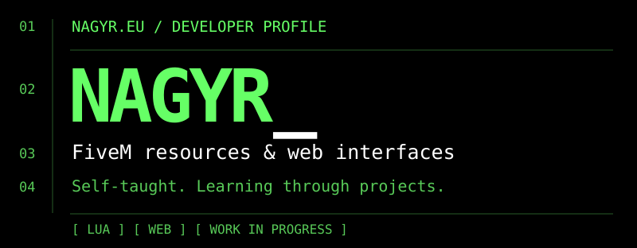

  <picture>
  <source media="(max-width: 600px)" srcset="assets/brand/nagyr-hero-mobile.svg" />
  
  </picture>

# NagyR — Roby

**Self-taught developer · FiveM & web development**

I learn by building things I can use: Lua resources for FiveM, in-game interfaces, and websites. My experience comes from independent projects and practical experimentation.

[Explore my portfolio](https://nagyr.eu/) · [Browse my repositories](https://github.com/trobo12345?tab=repositories)

## `01` / Selected projects

### [roby_keybinds](https://github.com/trobo12345/roby_keybinds)
A FiveM panel for registering, browsing, and saving key preferences, with a client event for integrating those changes into other resources.

Lua · React · TypeScript · Vite · Tailwind CSS

### [roby_items](https://github.com/trobo12345/roby_items)
An item browser for authorized ESX staff to retrieve items or give them to a player through ox_inventory.

Lua · JavaScript · HTML · CSS · ESX · ox_inventory

### [roby_weapondamage](https://github.com/trobo12345/roby_weapondamage)
A small client-side FiveM resource for configuring weapon damage multipliers and an optional headshot rule.

Lua · FiveM natives

## `02` / Technical skills

**Core Experience**  
Lua for FiveM resources; HTML, CSS, and JavaScript for interfaces. These are the main areas of my practical project work.

**Working Knowledge**  
React and TypeScript in project interfaces, Next.js in my portfolio, and ESX / ox_inventory integration. I use Git and npm in these projects.

**Currently Exploring**  
More structured Lua and FiveM development, Git workflows, and SQL. I am building my understanding through exercises alongside project work.

## `03` / Current work

I designed and built [nagyr.eu](https://nagyr.eu/). I am also developing **HibaPont**, a QR-based issue-reporting project. **In development.**

## `04` / Certifications

Online learning certifications from **freeCodeCamp**, issued to Nagy Róbert:

- [Legacy Responsive Web Design V8](https://www.freecodecamp.org/certification/nroby/responsive-web-design)
- [Legacy JavaScript Algorithms and Data Structures V8](https://www.freecodecamp.org/certification/nroby/javascript-algorithms-and-data-structures-v8)
- [Frontend Development Libraries V8](https://www.freecodecamp.org/certification/nroby/front-end-development-libraries)

## `05` / Contact

Find my work and public contact options at [nagyr.eu](https://nagyr.eu/).

---

<code>NAGYR_</code> · Built through practice.
